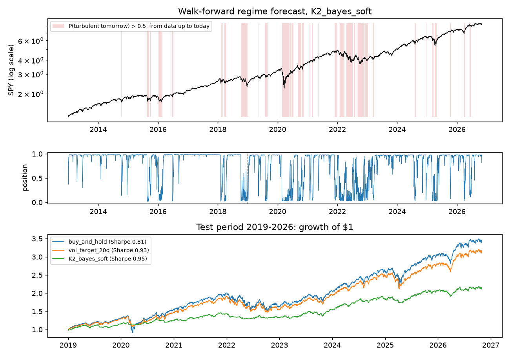
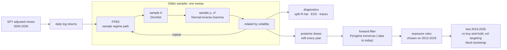

# bayesian-regime-hmm

[](https://github.com/John-Ferd/bayesian-regime-hmm/actions/workflows/ci.yml) 

A regime-switching hidden Markov model for **real SPY daily returns (2000 to October 2026)**, fitted the Bayesian way. A Gibbs sampler draws whole regime paths with **forward-filtering backward-sampling (FFBS)** and draws the parameters from conjugate **Dirichlet** and **Normal-Inverse-Gamma** posteriors, all written from scratch in NumPy. The project then asks two practical questions, answered strictly out of sample: does a trading rule that steps out of the market in the turbulent regime actually help, and does Bayesian parameter uncertainty add anything over a single point estimate?

> **Project history:** first built earlier in 2026. In November 2026 it was rebuilt into a tested, reproducible package and published here, so the commit history starts then. All numbers in this README come from this published version.

## In one paragraph

Returns are assumed to come from a small number of hidden regimes with their own mean and volatility; regimes persist from day to day according to a transition matrix. Instead of one best parameter set (as EM does in [gaussian-hmm-regime-detection](https://github.com/John-Ferd/gaussian-hmm-regime-detection)), the sampler produces thousands of plausible parameter sets, so every estimate comes with a credible interval. Refit every year on all earlier data and traded with no lookahead, the configuration chosen on 2013-2018 raised the 2019-2026 Sharpe ratio from **0.81 (buy-and-hold) to 0.95** and cut the worst drawdown from **−34% to −12%**, at the price of a lower total return. Two honest findings: the improvement is **not statistically significant**, and **averaging over parameter uncertainty made no measurable difference** compared with plugging in the posterior mean.

## Data and protocol

SPY daily log returns of adjusted closes, 6,747 trading days from Yahoo Finance (`make spy` downloads them once into `data/`). Periods are used strictly in order:

| period | years | used for |
|---|---|---|
| train | 2000-2012 | the first fits |
| validation | 2013-2018 (1,510 days) | choosing the configuration |
| test | 2019-Oct 2026 (1,969 days) | reported once; nothing is chosen on it |

**Walk-forward.** For every year from 2013 on, the Gibbs sampler (1,000 kept draws after 500 burn-in) is run on all data before that year. The year is then traded with parameters frozen, using only the regime forecast made at each previous close:

P(regime tomorrow = j | data up to today) = Σ_k P(s_t = k | y₁..t) · A[k, j]

from the forward filter, which never looks ahead. There is a 2 bp cost per unit of turnover.

**Configurations compared on validation (12):**
- 2 or 3 regimes;
- a "point" forecast (posterior-mean parameters plugged in) or a "Bayesian" forecast (averaged over 200 posterior draws);
- three exposure rules:
  - **hard:** in the market unless P(turbulent tomorrow) > 0.5;
  - **soft:** exposure = 1 − P(turbulent tomorrow);
  - **soft_confident:** the soft exposure times (1 − normalized entropy of the regime forecast), which holds less when the model can't tell the regimes apart. This idea comes from an earlier version of this project.

## Results

### 1. The posterior (full sample, 4 chains × 2,000 draws; descriptive only)

| parameter (K = 2) | posterior mean | 95% credible interval | R-hat | ESS |
|---|---|---|---|---|
| mean daily return, turbulent | −0.106% | [−0.191%, −0.020%] | 1.000 | 7,169 |
| mean daily return, calm | +0.089% | [+0.068%, +0.110%] | 1.000 | 5,392 |
| annual volatility, turbulent | 30.8% | [29.6%, 32.1%] | 1.002 | 2,452 |
| annual volatility, calm | 11.0% | [10.7%, 11.4%] | 1.001 | 1,529 |
| P(stay turbulent tomorrow) | 0.969 | [0.958, 0.979] | 1.001 | 2,121 |
| P(stay calm tomorrow) | 0.987 | [0.982, 0.991] | 1.000 | 1,813 |

- All R-hat values are ≤ 1.003 for both K = 2 and K = 3, below the 1.01 warning level. The minimum ESS is 1,529 (K = 2) and 918 (K = 3).
- The turbulent regime loses money on average, and its interval excludes zero. Regimes last a long time: about 32 days for turbulent and 77 days for calm on average.
- The three-regime fit splits the data into calm (8.7% vol), normal (19.0%) and crisis (47.1%) regimes.

### 2. Does trading on the regime help? (test period 2019-2026)

| strategy | Sharpe | annual return | annual vol | max drawdown | avg exposure |
|---|---|---|---|---|---|
| buy and hold | 0.81 | 16.9% | 19.2% | −33.7% | 1.00 |
| volatility targeting (20-day) | 0.93 | 15.6% | 15.6% | −22.9% | 0.96 |
| **K = 2, Bayesian, soft** (chosen on validation) | **0.95** | 10.1% | 10.1% | **−11.7%** | 0.72 |
| K = 2, point estimate, soft | 0.94 | 10.1% | 10.1% | −11.8% | 0.72 |
| K = 2, Bayesian, soft_confident | 0.71 | 5.1% | 7.0% | −9.6% | 0.49 |
| K = 3, Bayesian, soft (not chosen) | 1.06 | 16.7% | 14.5% | −20.0% | 0.93 |

<p align="center"></p>

- **Risk is cut much more than return.** The chosen rule has a third of buy-and-hold's worst drawdown and a higher Sharpe ratio, but it is out of the market much of the time, so $1 grew to about $2.10 instead of $3.40.
- **Not statistically significant.** A stationary block bootstrap (20-day blocks, 2,000 resamples) gives a 95% interval for the Sharpe gain of **[−0.42, +0.66]** against buy-and-hold and **[−0.41, +0.44]** against volatility targeting.
- **Bayesian vs point estimate: no difference.** Same K and rule, the Sharpe difference is 0.001 with a 95% interval of [−0.002, +0.004]. With thousands of training days the posterior is narrow, so averaging over it barely moves the forecast. Parameter uncertainty is useful for *knowing how sure you are* (the intervals above), not for trading better here.
- **Confidence scaling hurt.** Scaling exposure down when the regime forecast is uncertain cut the Sharpe ratio from 0.95 to 0.71 (on validation too: 0.92 vs 0.97). It held only 49% exposure on average, giving up much more return than it saved in drawdown.
- **The 3-regime model did better on the test period** (Sharpe 1.06) but worse on validation (0.81 vs 0.97), so it was not chosen. Switching to it now would be choosing with hindsight.
- Volatility targeting is the simple benchmark any "step aside in turbulence" rule should beat, and on this test period the HMM rule's edge over it is small.

## Architecture



## How it works

**The model.**
- s₁ is uniform.
- s_t | s_{t−1} follows row s_{t−1} of the transition matrix A.
- y_t | s_t = k ~ N(μ_k, σ_k²), for K = 2 or 3 regimes.

**Priors**, chosen to be conjugate so that every Gibbs step is an exact draw:
- each row of A ~ Dirichlet, with extra weight on staying in the same regime (10 vs 1);
- σ_k² ~ Inverse-Gamma;
- μ_k | σ_k² ~ Normal (this pair is the Normal-Inverse-Gamma prior).

**One Gibbs sweep:**
1. **Draw the whole regime path with FFBS.** Run the forward filter to get P(s_t | y₁..t) for every day. Then sample backwards: draw s_T from the last filtered probability, then each earlier s_t from P(s_t | y₁..t) · A[s_t, s_{t+1}]. Drawing the path jointly mixes much better than updating one day at a time, because neighbouring days' regimes are strongly correlated.
2. **Draw A.** With the path fixed, count the transitions out of each regime. Each row of A then has a Dirichlet(prior + counts) posterior.
3. **Draw μ_k, σ_k².** With the path fixed, the returns in regime k are just normal data, so the Normal-Inverse-Gamma posterior has a closed form (`nig_posterior`).

**Label switching.** Renaming the regimes gives exactly the same likelihood, so a sampler can flip labels partway through a run and the averages become meaningless. After each sweep I relabel so that state 0 is always the highest-volatility regime. I order by volatility rather than by mean because the means overlap a lot (see the wide μ intervals above), so ordering by mean would itself keep flipping.

**Diagnostics.** 4 chains from random starts; split R-hat and effective sample size for every parameter, with the same from-scratch code as in [mcmc-sampler](https://github.com/John-Ferd/mcmc-sampler).

**Causal trading.** Smoothed probabilities P(s_t | y₁..T) use future data, which would make a backtest look much better than reality. Every position here comes from the forward filter and from parameters fitted only on earlier years. Tests check that adding future data never changes past signals.

**Statistical honesty.** Sharpe ratios on a few years of data are noisy, so every comparison on the test period comes with a stationary block-bootstrap interval. Resampling whole blocks keeps volatility clustering, which an i.i.d. bootstrap would destroy, and so would understate the uncertainty.

## Tests

`make test` runs 14 tests. They use small simulated sequences where the true regimes are known, which is the only way to check a sampler's correctness exactly. The experiment itself uses only real data.
- FFBS draw frequencies match exact forward-backward smoothing.
- The Normal-Inverse-Gamma update matches a hand calculation.
- Relabelling reorders states and transitions consistently; a 3-state sampler keeps states ordered by volatility.
- The sampler recovers known volatilities and regimes.
- Regime forecasts are proper distributions, are causal, and averaging identical posterior draws equals using one.
- Exposure rules and the normalized entropy behave as defined; volatility targeting is causal and capped.
- The backtest applies yesterday's position to today's return; max drawdown is computed correctly.
- R-hat and ESS behave correctly on i.i.d. draws; the bootstrap interval contains its point estimate.

## How to run

```bash
pip install -e ".[dev]"     # or: make setup
make test
make spy                    # downloads SPY once (needs internet); ~10 minutes on a multi-core machine
                            # -> artifacts/results_SPY.json, backtest_SPY.png, traces_SPY.png
```

Adjusted prices are rescaled by a constant whenever a new dividend is paid, which leaves log returns, and so every number here, unchanged between downloads.

## Limitations

- Gaussian returns within a regime. Real returns have fat tails, and the model partly absorbs them by calling volatile days "turbulent".
- One asset and one test period with essentially one crash, which is why no strategy difference is significant.
- Parameters are frozen for a year between refits; regime lengths in an HMM are geometric (memoryless), which real market regimes need not be.
- The transaction cost is a flat 2 bp per unit of turnover; the chosen rule trades about 16 units a year, so costs matter more for it than for buy-and-hold.
