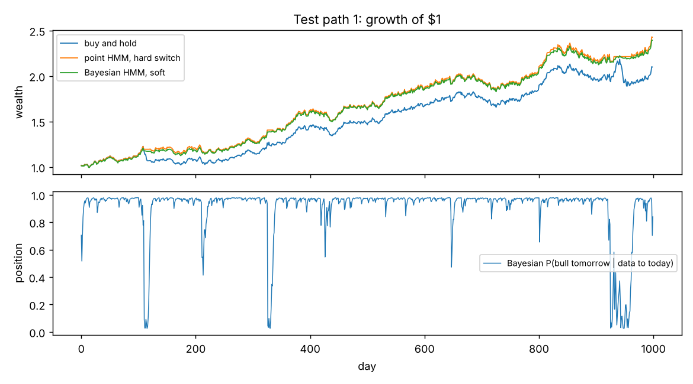
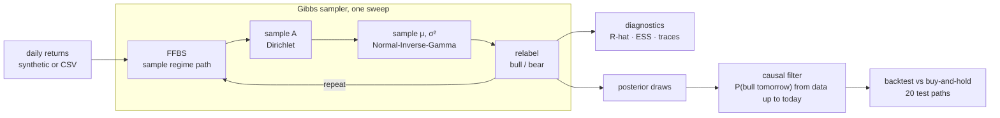

# bayesian-regime-hmm

[](https://github.com/John-Ferd/bayesian-regime-hmm/actions/workflows/ci.yml) 

A two-regime ("bull" / "bear") hidden Markov model for daily returns, fitted the Bayesian way. A Gibbs sampler draws whole regime paths with **forward-filtering backward-sampling (FFBS)** and draws the parameters from conjugate **Dirichlet** and **Normal-Inverse-Gamma** posteriors. Everything is written from scratch in NumPy. The project then asks a practical question: does a trading rule that switches out of the market in the bear regime actually help, and does Bayesian uncertainty add anything over a single point estimate?

> **Project history:** first built earlier in 2026. In November 2026 it was rebuilt into a tested, reproducible package and published here, so the commit history starts then. All numbers in this README come from this published version.

## In one paragraph

Returns are assumed to come from one of two hidden regimes: a calm one (low volatility, positive drift) and a turbulent one (high volatility, negative drift). Regimes persist from day to day according to a 2×2 transition matrix. Instead of finding one best parameter set (as EM does in [gaussian-hmm-regime-detection](https://github.com/John-Ferd/gaussian-hmm-regime-detection)), the Gibbs sampler produces thousands of plausible parameter sets, so every estimate comes with a credible interval. On synthetic data with known truth:
- all 6 parameters' 95% intervals contain the true values;
- all chains agree (R-hat ≤ 1.001).

A causal trading rule built on the model roughly **doubles the Sharpe ratio of buy-and-hold (1.18 vs 0.59)** and cuts the average maximum drawdown from **−33% to −13%**. The honest second finding: **averaging over parameter uncertainty did not beat simply plugging in the posterior mean**. Most of the benefit comes from detecting the regime, not from being Bayesian about the parameters.

## Results

### 1. Parameter recovery (2,000 training days, 4 chains × 2,000 draws, `make experiment`)

| parameter | truth | posterior mean | 95% credible interval | R-hat | ESS |
|---|---|---|---|---|---|
| μ bear (daily mean) | −0.00150 | −0.00132 | [−0.00288, 0.00025] | 1.001 | 7,449 |
| μ bull | 0.00080 | 0.00072 | [0.00028, 0.00116] | 1.000 | 6,938 |
| σ bear (daily vol) | 0.0200 | 0.0197 | [0.0186, 0.0209] | 1.000 | 5,730 |
| σ bull | 0.0080 | 0.0080 | [0.0077, 0.0084] | 1.000 | 5,247 |
| P(stay in bear) | 0.970 | 0.974 | [0.959, 0.986] | 1.000 | 4,508 |
| P(stay in bull) | 0.990 | 0.987 | [0.980, 0.993] | 1.000 | 4,582 |

All six intervals contain the truth. ESS is out of 8,000 draws. Note how wide the interval for the bear mean is: it includes zero. With only 647 bear days, the data cannot tell a slightly negative drift from no drift. The volatilities, by contrast, are pinned down tightly, and volatility is what actually separates the two regimes.

### 2. Does trading on the regime help? (20 new test paths of 1,000 days each)

Every rule decides tomorrow's position using only data up to today's close. There is a 1 bp cost per unit of turnover.

| strategy | position held tomorrow | mean Sharpe | mean max drawdown | worst max drawdown |
|---|---|---|---|---|
| buy and hold | always 1 | 0.59 | −32.5% | −56.3% |
| point estimate, hard switch | 1 if P(bull) > 0.5, else 0 | **1.20** | −13.7% | −27.8% |
| point estimate, soft | P(bull) | 1.18 | **−12.9%** | **−22.4%** |
| Bayesian, soft | P(bull) averaged over 200 posterior draws | 1.18 | **−12.9%** | **−22.4%** |

"Point estimate" uses the posterior-mean parameters, plugged in as if they were exact.

- **Regime filtering clearly helps:** the Bayesian rule had a higher Sharpe than buy-and-hold on **20 of 20** test paths. Stepping aside in the high-volatility regime avoids most of the large drawdowns.
- **Soft vs hard:** scaling the position by the probability gives smaller worst-case drawdowns (−22% vs −28%) with about the same Sharpe.
- **Bayesian vs point estimate: no real difference.** The two soft rules match to two decimals. With 2,000 training days the posterior is narrow, so averaging over it barely changes P(bull). I also reran with only **250 training days** (`make scarce`), where parameter uncertainty is much larger. The Bayesian rule still only tied the point-estimate soft rule: Sharpe 1.00 vs 1.00, higher on 10 of 20 paths.

So the honest conclusion is that in this setup, parameter uncertainty is useful for *knowing how sure you are* (the intervals above), not for trading better.

<p align="center"></p>

**Caveat:** the data was simulated from the same kind of model, with a bear regime that really does lose money. That is the best case for this strategy. It shows the method works when its assumptions hold, not that it would beat the real market.

## Architecture



## How it works

**The model.**
- s₁ is uniform.
- s_t | s_{t−1} follows row s_{t−1} of the transition matrix A.
- y_t | s_t = k ~ N(μ_k, σ_k²).

**Priors**, chosen to be conjugate so that every Gibbs step is an exact draw:
- each row of A ~ Dirichlet, with extra weight on staying in the same regime (10 vs 1);
- σ_k² ~ Inverse-Gamma;
- μ_k | σ_k² ~ Normal (this pair is the Normal-Inverse-Gamma prior).

**One Gibbs sweep:**
1. **Draw the whole regime path with FFBS.** Run the forward filter to get P(s_t | y₁..t) for every day. Then sample backwards: draw s_T from the last filtered probability, then each earlier s_t from P(s_t | y₁..t) · A[s_t, s_{t+1}]. Drawing the path jointly mixes much better than updating one day at a time, because neighbouring days' regimes are strongly correlated.
2. **Draw A.** With the path fixed, count the transitions out of each regime. Each row of A then has a Dirichlet(prior + counts) posterior.
3. **Draw μ_k, σ_k².** With the path fixed, the returns in regime k are just normal data, so the Normal-Inverse-Gamma posterior has a closed form (`nig_posterior`).

**Label switching.** Swapping the names "bull" and "bear" gives exactly the same likelihood, so a sampler can flip labels partway through a run and the averages become meaningless. After each sweep I relabel so that state 0 is always the higher-volatility one. I order by volatility rather than by mean because the two means overlap a lot (see the wide μ interval above), so ordering by mean would itself keep flipping.

**Diagnostics.** I run 4 chains from random starts and compute split R-hat and effective sample size for every parameter (same from-scratch code as in [mcmc-sampler](https://github.com/John-Ferd/mcmc-sampler)).

**Causal trading rule.** P(bull tomorrow | data up to today) = Σ_k P(s_t = k | y₁..t) · A[k, bull], from the forward filter only. The smoothed probabilities P(s_t | y₁..T) use future data, which would make a backtest look much better than reality. A test checks that adding future data never changes past signals.

## Tests

`make test` runs 9 tests:
- FFBS draw frequencies match exact forward-backward smoothing.
- The Normal-Inverse-Gamma update matches a hand calculation.
- Relabelling reorders states and transitions consistently.
- The sampler recovers volatilities and regimes.
- Trading signals are causal.
- Averaging identical posterior draws equals using one.
- The backtest applies yesterday's position to today's return.
- Max drawdown is computed correctly.
- R-hat and ESS behave correctly on i.i.d. draws.

## How to run

```bash
pip install -e ".[dev]"     # or: make setup
make test
make experiment             # ~2.5 min: tables above, artifacts/results.json, traces.png, backtest.png
make scarce                 # same with 250 training days
make spy                    # real SPY returns via yfinance (pip install -e ".[real-data]", needs internet)
```

`make spy` fits on the first 70% of SPY's history since 2005 and backtests on the last 30%. Those results are not included here because this version was built without market-data access.

## Limitations

- Two regimes with Gaussian returns. Real returns have fat tails, and the model partly absorbs them by calling volatile days "bear".
- The backtest is on simulated data from the model's own family, which is its best case.
- Regime lengths in an HMM are geometric (memoryless), which real market regimes need not be.
